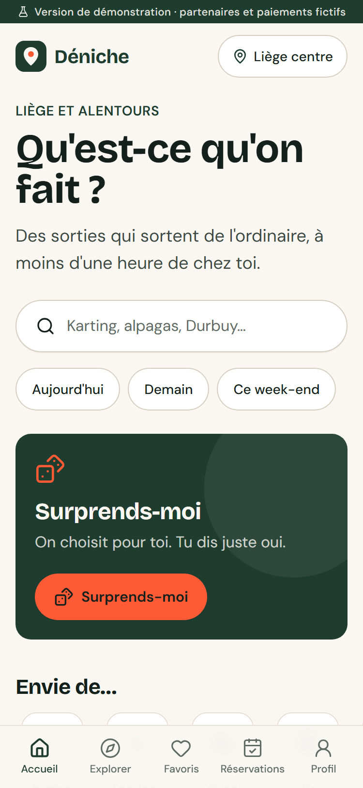
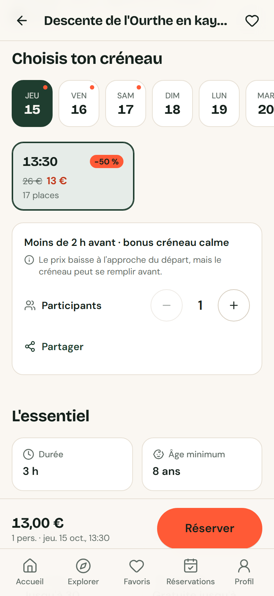
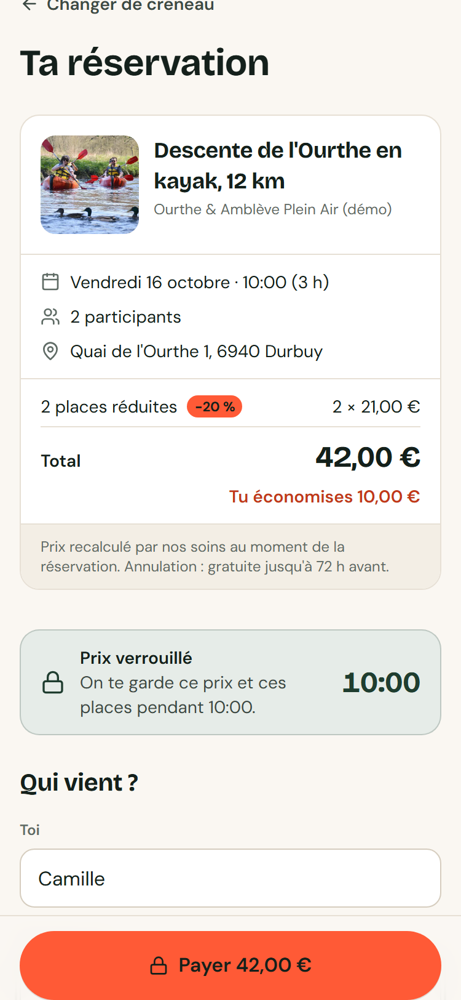
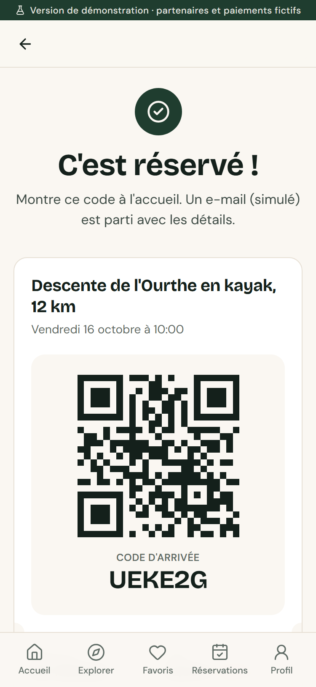
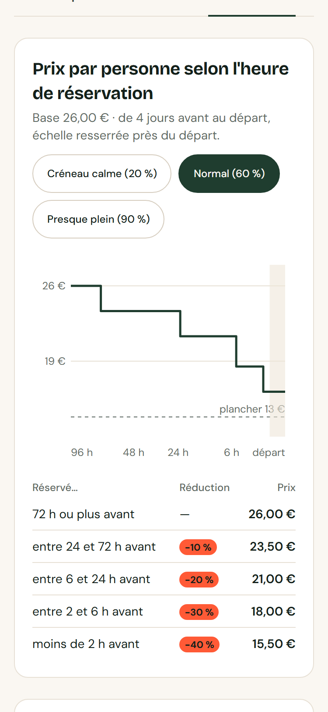

# Déniche

> Trouve une activité originale près de toi, réserve un créneau en 3 clics, et paie moins cher quand tu réserves au dernier moment.

Prototype d'application web mobile-first pour découvrir et réserver des activités de loisirs « niche » à Liège et alentours (≈ 60 km) : karting, bloc et escalade, quad et buggy, paintball et tir à l'arc, kayak, trail, trottinette, ateliers créatifs et culinaires, balades avec des animaux.

Projet étudiant — cours **Startech**, HELMo Gramme (Liège). **Version de démonstration** : partenaires, avis et paiements sont fictifs.

| Accueil | Fiche et créneaux | Paiement | Confirmation | Partenaire : réductions |
|---|---|---|---|---|
|  |  |  |  |  |

Toutes les captures (375 px et 1280 px) sont dans [`docs/screens/`](docs/screens).

---

## Lancer la démo

Prérequis : **Node.js 20 ou plus** (testé avec Node 24 LTS).

```bash
npm install
npm run seed
npm run dev
```

Puis ouvre <http://localhost:3000>. Aucune clé, aucun service externe : la base SQLite est créée dans `prisma/dev.db`, les paiements et les e-mails sont simulés.

`npm run seed` remet la base à zéro : 5 partenaires fictifs, 18 activités, des créneaux sur les 14 derniers jours et les 21 prochains (calculés à partir de la date du jour), environ 2 000 réservations simulées avec des taux de remplissage variés. Les créneaux se prolongent ensuite tout seuls, jour après jour.

### Comptes démo

Sur la page **Connexion**, deux boutons ouvrent directement une session :

| Compte | E-mail | Ce qu'il permet |
|---|---|---|
| Connexion démo · utilisateur | `camille@demo.deniche.be` | réserver, favoris, réservations à venir et passées |
| Connexion démo · partenaire | `partenaire@demo.deniche.be` | espace `/partenaire` de « Ourthe & Amblève Plein Air (démo) » |

On peut aussi saisir n'importe quel e-mail : le **lien magique** est simulé et affiché à l'écran (et dans la console du serveur).

**Paiement simulé** : la carte `4242 4242 4242 4242` est acceptée, la carte `4000 0000 0000 0002` est refusée (pour montrer le message d'erreur). Bancontact est simulé aussi.

### Parcours à montrer au jury (≈ 3 minutes)

1. **Accueil** → « Dernière minute près de toi » → une carte avec un badge `−30 %`.
2. Sur la fiche, le créneau est déjà présélectionné : prix barré, compte à rebours vers le palier suivant (« −40 % dans 1 h 50 »), message honnête sur le remplissage.
3. **Réserver** → connexion démo → **Payer** : le prix est verrouillé 10 minutes.
4. **Confirmation** : QR code, code d'arrivée, `.ics`, « Partager à mes amis ».
5. Dans un autre navigateur (ou en navigation privée), **Connexion démo · partenaire** → **Réservations** : la réservation arrive avec le badge « Nouveau ». **Accueil** → saisis le code → **Valider l'arrivée**.
6. **Activités** → une activité → **Réductions** : modifie un palier et regarde la courbe de prix bouger en direct.
7. Bonus : **Surprends-moi**, la bascule **Carte** dans Explorer, et l'installation en PWA.

---

## Roue de la chance et carte fidélité

- **Surprends-moi** ouvre une roue de 8 activités (une par catégorie, la plus proche). Le tirage est fait par le serveur, avec la même pondération qu'avant : catégories jamais essayées, activités à moins de 40 km, créneaux en réduction. La roue s'arrête ensuite sur l'activité tirée. Avec « mouvement réduit » activé, elle ne tourne pas.
- **Carte fidélité** (Profil) : un tampon par sortie **validée à l'arrivée** par le partenaire. Tous les 3 tampons, un cadeau sur place (boisson offerte, en-cas offert, petit souvenir). Au paiement, le client coche « Utiliser mon cadeau ». Le partenaire voit « Cadeau à remettre » en validant l'arrivée, et le cadeau passe alors en « utilisé ». Si la réservation est annulée ou expire, le cadeau redevient disponible. Les cadeaux ne changent pas le prix payé.
- Compte démo : Camille a déjà 3 sorties validées et une boisson offerte à utiliser.

---

## Tarification dynamique

Le cœur du produit est une fonction pure, testée : [`src/lib/pricing.ts`](src/lib/pricing.ts)

```ts
computePrice({ basePriceCents, startsAt, now, tiers, floorPct, fillRate, lastMinuteEnabled, … })
// → { unitPriceCents, discountPct, tierLabel, nextChangeAt, nextDiscountPct, … }
```

Règles par défaut (chaque partenaire peut les changer par activité, avec un aperçu en temps réel) :

| Heures avant le début | Réduction |
|---|---|
| 72 h ou plus | 0 % |
| de 24 h à 72 h | −10 % |
| de 6 h à 24 h | −20 % |
| de 2 h à 6 h | −30 % |
| moins de 2 h | −40 % |

- **Bornes** : un palier s'applique dès qu'il reste *au moins* son nombre d'heures (72 h pile → 0 %, 24 h pile → −10 %, etc.).
- **Plancher** : jamais moins de `floorPct` du prix de base (50 % par défaut).
- **Quota** : au plus 50 % de la capacité d'un créneau à prix réduit. Pour un groupe qui dépasse le quota, seules les places restantes sont réduites, et le récapitulatif l'explique.
- **Remplissage** : moins de 40 % rempli et moins de 24 h avant → +10 points (dans la limite du plancher). Plus de 80 % rempli → aucune réduction.
- **Fermeture** : réservations fermées 30 min avant le début (paramétrable).
- **Arrondi** : au 0,50 € le plus proche, sans jamais passer sous le plancher.
- **Dernière minute** : option activable ou non par le partenaire.
- **Changement d'heure** : les heures restantes sont des heures réelles (écart entre deux instants UTC). Le 25 octobre 2026, un créneau garde le bon palier (testé).

**Côté serveur** : le serveur est l'unique source de vérité. Au clic sur « Réserver », il recalcule le prix, bloque les places et verrouille le prix pendant 10 minutes. La place est prise par une mise à jour conditionnelle atomique (`bookedCount ≤ capacité − n`) dans une transaction : impossible de surréserver. Un test lance 10 clients sur les 3 dernières places, et seuls 3 réussissent.

---

## Pile technique

| | |
|---|---|
| App | Next.js 16 (App Router, Server Actions) · React 19 · TypeScript strict |
| UI | Tailwind CSS 4 · Bricolage Grotesque + DM Sans (`next/font`) · icônes Lucide |
| Données | Prisma 7 + SQLite (adaptateur libSQL), schéma compatible PostgreSQL · montants en centimes |
| Validation, dates | Zod 4 · date-fns 4 + `@date-fns/tz` (fuseau `Europe/Brussels`) |
| Carte | Leaflet + OpenStreetMap (sans clé) |
| Paiement | interface `PaymentProvider` : `MockProvider` (défaut) · `StripeProvider` (mode test, carte + Bancontact) |
| PWA | manifest, icônes, service worker (réseau d'abord pour les pages, page hors ligne) |
| Tests | Vitest (prix, concurrence, `.ics`) · Playwright (parcours complets, mobile et desktop) |

Les choix faits en cours de route sont expliqués dans [`DECISIONS.md`](DECISIONS.md).

### Scripts

| Commande | Rôle |
|---|---|
| `npm run dev` | serveur de développement |
| `npm run seed` | crée le schéma et (re)génère les données de démo |
| `npm test` | tests Vitest (59 tests) |
| `npm run e2e` | tests Playwright (lance le serveur si besoin). La première fois : `npx playwright install chromium` |
| `npm run build` / `npm start` | build de production (le service worker n'est actif qu'en production) |
| `npm run lint` · `npm run typecheck` · `npm run format` | qualité |
| `node scripts/capture-docs.mjs` | régénère `docs/screens/` (serveur lancé) |

### Mettre en ligne (Render, gratuit)

Le fichier [`render.yaml`](render.yaml) décrit le déploiement. Sur [render.com](https://render.com) : **New + → Blueprint**, choisir ce dépôt, puis **Apply**. Render installe, construit, remplit la base de démo à chaque démarrage et sert l'appli en HTTPS.

Limites de l'offre gratuite : mise en veille après 15 minutes sans visite (premier chargement d'environ 50 s ensuite), et base remise à zéro à chaque redémarrage. Pour une démo, c'est plutôt un avantage.

### Activer Stripe (mode test)

Dans `.env` (voir `.env.example`) :

```env
PAYMENT_PROVIDER="stripe"
STRIPE_SECRET_KEY="sk_test_…"
APP_URL="http://localhost:3000"
```

Le paiement passe alors par Stripe Checkout (carte et Bancontact). Seules les clés `sk_test_` sont acceptées.

### Organisation du code

```
src/app/(app)/        écrans utilisateur (accueil, explorer, fiche, favoris, réservations, profil, légal)
src/app/reserver/     checkout (prix verrouillé, paiement)
src/app/partenaire/   espace partenaire (tableau de bord, activités, créneaux, réductions, accueil)
src/app/actions/      Server Actions (auth, réservation, favoris, partenaire)
src/lib/pricing.ts    moteur de prix (pur, testé)
src/lib/booking.ts    verrou, concurrence, confirmation, annulation
src/lib/payments/     PaymentProvider, Mock, Stripe
src/lib/copy.ts       tous les textes de l'interface (fr-BE), prêts à traduire
prisma/               schéma, seed, contenu de démo, crédits photos
data/                 partenaires-candidats.json (prospection, jamais affiché)
```

---

## Limites connues

- **Prototype** : SQLite en fichier local, un seul processus serveur. Les verrous expirés sont libérés de façon paresseuse (à la lecture), pas par une tâche planifiée.
- **E-mails simulés** : rien n'est envoyé. Le contenu s'affiche dans la console du serveur, et le lien magique à l'écran.
- **Stripe** : intégration écrite d'après le SDK officiel mais **non testée avec une vraie clé** pendant le développement. Le mode Mock est celui de la démo.
- **Scan du QR** : utilise l'API `BarcodeDetector` (Chrome et Edge, Android compris). Sur Safari iOS, on saisit le code à 6 caractères.
- **Temps de trajet** : estimation (distance × 1,3, vitesse moyenne), pas un calcul d'itinéraire. Position par défaut : Liège centre.
- **Photos** : libres de droits (Wikimedia Commons, voir `public/images/activities/CREDITS.md`). Elles illustrent l'activité mais ne viennent pas des lieux réels. Les photos envoyées par un partenaire sont stockées localement dans `uploads/`.
- **Avis** : maquette, marqués comme tels.
- **Pages légales** : modèles **à valider** par un juriste.
- **Tests e2e** : ils créent de vraies réservations dans la base de démo. `npm run seed` remet tout à zéro.
- **Une seule langue** (fr-BE). Tous les textes de l'interface et les messages d'erreur sont centralisés dans `src/lib/copy.ts`. Les modèles juridiques sont dans `src/lib/legal.ts` et le contenu de démo (activités, partenaires) dans `prisma/seed-data.ts`.

## Pistes

Hors périmètre pour ce prototype :

- **Paiement partagé entre amis** : chacun paie sa place depuis le lien de partage, avec un délai pour que le groupe se complète.
- **Fidélité, plus loin** : cadeaux choisis et financés par chaque partenaire, badges par catégorie essayée, parrainage.
- **Vrais avis**, vérifiés : seulement après une arrivée validée.
- **Application native** (iOS/Android) : notifications « −40 % sur ton activité favorite ».
- Alertes de prix sur un créneau, liste d'attente quand c'est complet.
- Calcul d'itinéraire réel et transports en commun (TEC, SNCB).
- Tableau de bord partenaire : export comptable, factures, versements.
- Prospection : contacter les prestataires de [`data/partenaires-candidats.json`](data/partenaires-candidats.json) (liste corrigée, à vérifier).

## Crédits

- Photos : Wikimedia Commons, licences CC0 / CC BY / CC BY-SA, détail dans [`CREDITS.md`](public/images/activities/CREDITS.md).
- Fonds de carte : © contributeurs OpenStreetMap.
- Polices : Bricolage Grotesque, DM Sans (Google Fonts, SIL OFL).
